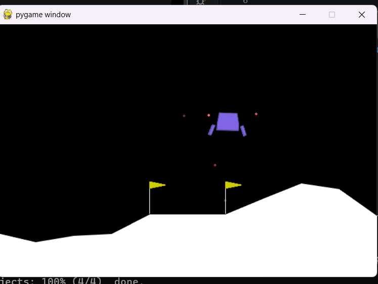
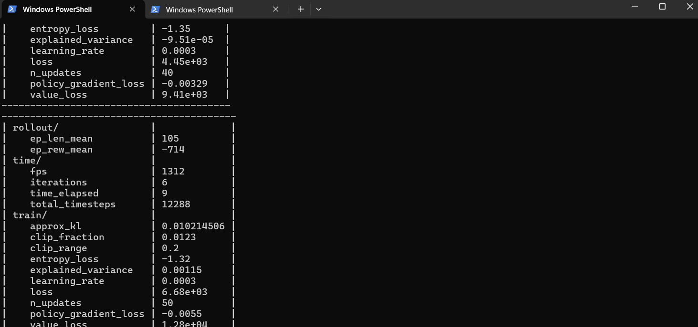
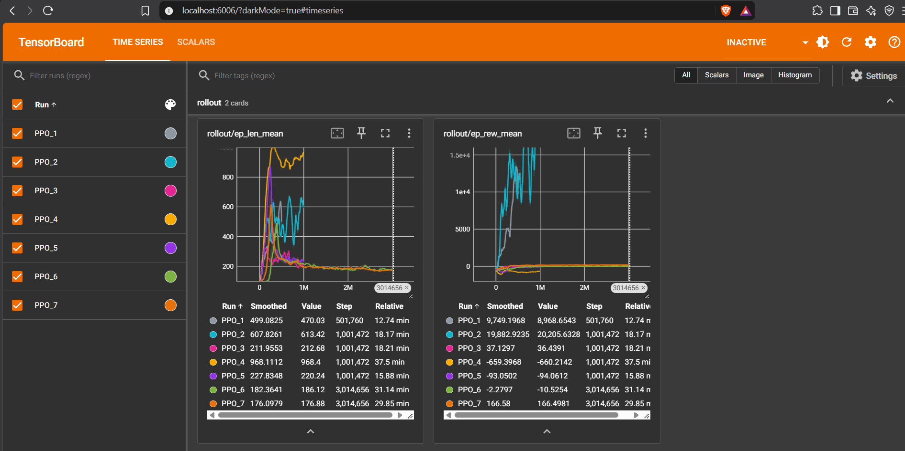
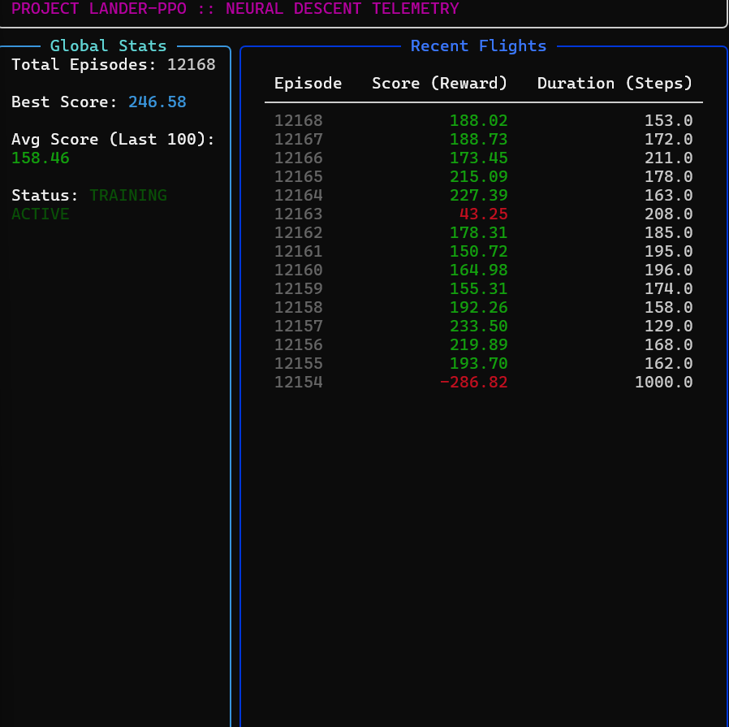
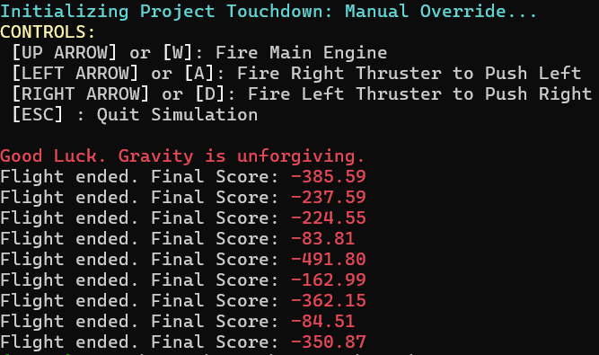
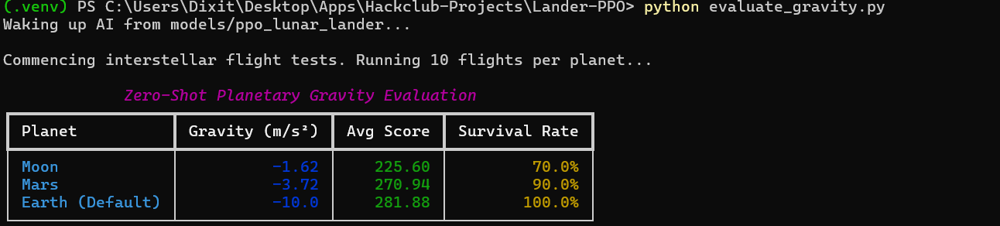
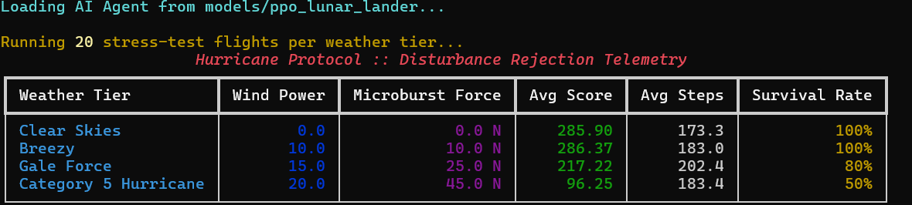

# Lander-PPO


# What is this Project in breif
**Lander-PPO**, is a project where an AI agent is trained to land a rocket using Reinforcement Learning, the Proximal Policy Optimization (PPO) algorithm, and custom reward shaping techniques.

# How it works?
AI sees the world as an array of 8 numbers (X/Y coordinates, velocities, tilt angle, and leg contact) provided by the Gymnasium environment. By default, it struggles to land efficiently. I implemented a custom Python wrapper to intercept the physics engine and apply **Reward Shaping**.

**Here is how training evolved:**
Firstly there was some basic stuff like testing environment to see if everything works or no and smaller steps model training to see results and build tools to see different results to improve.

Get to the ground Fix:- AI also used a loophole which would give it good amount of points if it landed rocket at ground so to get that massive points it started to ignore the final destination where rocket should land and it was just prioritzing landing the rocket on ground anywhere.

Burn Exploit Fix:- AI realised that buring more fule will result in decreased points so to get more reward it decided to freefall and then burst the engine when reaching ground and even after that burst it was very noticable that rocket was slamming into the ground. I had to fix it by reducing the fuel using penelty.

Hovering Loophole Fix:- AI is again trying to outsmart me and after fixing Burn Exploit Fix where i made using fuel a bit cheap and said to make vertical speed good for landing. Ai concluded that going down, landing with a perfect speed is hard so as fuel is cheap it will just float above the target. To fix this we introduce TIME TAX which will give AI an urgency to land which should fix this problem.

3 Million Model:- Now my rules were set and they are now hard for AI to follow so I have to train 3 Million Step Model but this would take a lot of time and to reduce that time i used some new tools(SubprocVecEnv) replacing old ones to use my CPU power to make 8 isolated environments working at same time to get result fast. Before there was only 1 environment doing things step by step without any help which was taking more time(hopefully my cpu will handel this well.)

Hyperparameter Tuning:- 3 Million Model is performing nicely now and following all my rules but those rules are a bit too harsh so points that AI is getting is still negative so i will now make those rules more easy so that it's easy for AI to follow and perform it's best. Lets see what the results will be after training.

Evaluate_gravity.py script:- After my latest 3 million model testing AI had become pretty good now so i decided to make a script where gravity will be changed according to the planets we have in solar system and AI have to land on those planet environment with training it has done on earth gravity. I saw both non video and video results and they were very obvious that survival rate was 100% on earth, 90% on mars and 60% on moon as it has very different gravity compared to earth and mars.

human_play.py:- I made a playable manual override version of this game using Pygame so a human can try to match the AI. Trust me, flying this manually on your own is incredibly difficult. It acts like a reverse-pendulum on rockets. Even getting a positive score is very hard, proving just how complex the AI's descent path really is.

evaluate_wind.py:- I made a new script to add realistic, unpredictable details to the environment, like sudden horizontal forces produced by wind according to different weather conditions( Breezy, Gale Force, and a Category 5 Hurricane). I wrote a custom Gymnasium Wrapper to directly inject these randomized wind microbursts into the physics engine. Then, I tested if my AI which was trained ina perfectly calm, normal environment would be able to handle this chaotic weather without any extra training. AI did pretty well even in Hurricane it gave 50% survival rate.


# Built With
**Python**: Core programming language used to write all scripts, custom wrappers, and training loops.

**Other Micro Tools/Libraries:**1. Stable-Baselines3: The reinforcement learning library that provided the PPO algorithm, actual "brain" of AI.

2. Gymnasium: The framework that provided the environment.

3. Box2D: The 2D physics engine providing gravity, collisions and winds etc.

4. Rich: Library to make CLI dashboard and other terminal scripts look good.

5. Pygame: Used to render visual game window and take human keyboard input when needed.

6. TensorBoard: Used to track the AI's math, graph, it's learining and monitor different stuff to decide future decisions.


**Curiosity**: The main fuel to build this project, it's always intresting to build something new, something different you have never done before.


# Images
















# How to Contribute

The best way to contribute is by simply downloading and using this AI, this project yourself. Test it and provide feedback.

**Report Bugs:** Did you find a crash with Pygame, a glitch in CLI dashboard or a dependency error when installing something? Let me know I will try my best to fix it.

**Suggest Ideas:** Share your ideas for new features, maybe better UI or some better tool.

**Code & English Corrections:** I wrote the code and typed the documentation myself, so there are probably a few spelling mistakes or places where the Python code could be optimized. If you spot any, please point them out!

How to reach me:
(If you are a developer, you are also welcome to open an Issue or a Pull Request right here on GitHub).

Other options are mail or slack which you can find in my websites. You will easly find repo and link for that.


# Deployment

Want to use the Trained AI? The final 3-million step model weights are officially hosted on Hugging Face. You can pull the AI directly into your own Python projects via the huggingface_sb3 library:
```Bash
from huggingface_sb3 import load_from_hub
from stable_baselines3 import PPO

checkpoint = load_from_hub(
    repo_id="Dixit106/ppo-LunarLander-v3",
    filename="ppo-LunarLander-v3.zip"
)

model = PPO.load(checkpoint)
```
**How to Run Locally**
Want to use other tools like cli_dashboard or want to fly rocket yourself? You just need Python installed on your computer.

OPEN YOUR TERMINAL:
1. Clone the repo:-
```Bash
git clone https://github.com/Dixit106/Lander-PPO.git
cd Lander-PPO
```

2. Create and activate a virtual environment to keep this seprate from your other projects:
On Windows:
```Bash
python -m venv .venv
.\.venv\Script\activate
```

On macOS/Linux:
```Bash
python -m venv .venv
source .venv/bin/activate
```

3. Install required libraries:
```Bash
pip install -r requirements.txt
```

4. Start launching any scripts:
If you want to play the game yourself:-
```Bash
python human_play.py
```

If you want to see AI score and performance in different weather condition:-
```Bash
python evaluate_wind.py
```

If you want to see survival of AI on Mars and Moon:-
```Bash
python evaluate_gravity.py
```

Live Terminal Dashboard: Watch AI while live training sessions:-
```Bash
python cli_dashboard.py
```
View Live graphs and Maths while you train the model:-
```Bash
tensorboard --logdir=logs
```

Want to Train AI yourself again:-
```bash
python train.py
```
**WARNING:** Only train AI if you know what you are doing, Training will use a lot of CPU power and if your system is not good enough it might crash or do damage to your hardware due to overheating.


